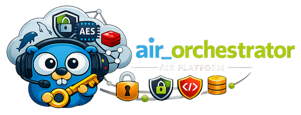

# AiR_Orchestrator



[🇷🇺 Русская версия](README.ru.md)


[](https://t.me/marusia_dev)

`air_orchestrator` is the central backend service of the AiR platform. It provides HTTP/gRPC APIs, manages users, conversations, AI models and integrations, and coordinates communication channels and supporting microservices.

## Features

- authentication, sessions, JWT, TOTP and access recovery;
- user, AI model, provider and conversation management;
- Telegram, WhatsApp, Avito and operator service integrations;
- Google OAuth, Calendar, Sheets and CRM integrations;
- MCP server with tools for AI models;
- realtime communication through WebSocket;
- internal gRPC API and voice-call proxy;
- MinIO/S3 file storage and Redis caching;
- Swagger/OpenAPI, Prometheus metrics and `pprof` profiling.

## User Data Protection

Each user receives an individual `MasterKey`. It is protected by the user's password and encrypts API keys, channel settings, conversations, Google tokens, CRM configurations, embeddings and file-storage settings. This data can only be decrypted after the user authenticates in the system with their individual password. Even if the database is compromised or leaked, all user data remains inaccessible both to attackers and to the service administration.

System secrets and sensitive `app_config` values are encrypted with a separate application master key using AES-GCM. The key is loaded from `APP_MASTER_KEY_FILE`; transactional key rotation is supported through `NEW_APP_MASTER_KEY_FILE` and `APP_CONFIG_REKEY`.

## Service dependency tree

```text
air_orchestrator
├── air_db (MariaDB/MySQL)
│   └── users, conversations, configuration and encrypted data
├── air_redis (Redis)
│   └── sessions and user MasterKey cache
├── minio (S3 storage)
│   └── user files
├── envoy
│   └── HTTPS/gRPC-Web gateway and external traffic routing
├── air_tgbot
├── air_tguserbot
├── air_whatsbot
├── air_avito
├── air_operator
├── marusia_crm
├── air_payment
└── air_lead-hunter

build/air-mon.yml
└── cadvisor ── Docker container metrics

build/air-vm.yml
└── victoriametrics ── metrics collection and storage

build/air-vlogs.yml
└── victorialogs ── logs collection and storage

build/air-vector.yml
└── vector ── Docker container log collection into VictoriaLogs

build/air-perses.yml
└── perses ── metrics and logs visualization
```

## Project structure

```text
.
├── build/         # Dockerfile, Makefile and compose files (dev.yml, prod.yml, air-*.yml)
├── cmd/           # application entry point
├── configs/       # .env and file-based secrets (secrets/ is not committed)
├── doc/           # OpenAPI contract
├── docs/          # generated Swagger files
├── envoy/         # Envoy gateway configuration (dev/prod)
├── internal/      # application code (delivery, usecase, repository, domain)
├── migrations/    # database migrations
└── monitoring/    # VictoriaMetrics, Vector and Perses configuration
```

Channel, CRM, payment and lead-hunting services communicate with the orchestrator through HTTP/gRPC contracts. The exact set of services depends on the deployment environment and Docker networks `air_shared`, `app_internal` and `monitoring_shared`.

## Technologies

Go 1.25, Gin, gRPC, Protocol Buffers, WebSocket, MariaDB/MySQL, Redis, MinIO/S3, AES-GCM, JWT, TOTP, Google OAuth, MCP Streamable HTTP, Docker, Envoy, Swagger/OpenAPI, VictoriaMetrics, VictoriaLogs, Perses, Vector and cAdvisor.

## Running

Create the external networks and prepare secrets:

```bash
docker network create air_shared
docker network create app_internal
docker network create monitoring_shared
```

Then copy `configs/secrets.example/` to `configs/secrets/` and fill in the values (see [secrets example](configs/secrets.example/README.md)).

For development, from the `build/` directory:

```bash
make up      # infrastructure + dev application
make logs
make down
```

Equivalent compose invocation (run from `build/`):

```bash
docker compose --env-file ../configs/.env -f dev.yml up -d
```

Configuration lives in `configs/` (`.env` + `secrets/`), build files in `build/` (Dockerfile, compose files, Makefile). Use `build/prod.yml` for production. Secrets are mounted from `configs/secrets/` and must not be committed.

## Monitoring

`build/air-vm.yml` starts VictoriaMetrics, which collects orchestrator, related-service, container (cAdvisor via `build/air-mon.yml`) and MinIO metrics every 30 seconds. `build/air-vlogs.yml` stores logs, `build/air-vector.yml` collects Docker container logs through docker.sock and ships them to VictoriaLogs. Visualization is provided by Perses (`build/air-perses.yml`, UI at `/perses/`, dashboards provisioned from `monitoring/perses`). All containers use the `json-file` logging driver with rotation limited to one 10 MB file.

## Documentation

- [OpenAPI](doc/openapi.yaml)
- [Calls gRPC contract](internal/delivery/grpc/v1/calls.proto)
- [VictoriaMetrics configuration](monitoring/victoriametrics/prometheus.yml)
- [Vector configuration](monitoring/vector.yaml)
- [Perses configuration and dashboards](monitoring/perses)
- [Docker build files](build) (Dockerfile, Makefile, compose files)

## Ecosystem marusia_ai

- [air-common](https://github.com/ikermy/air-common) — shared library for AI microservices
- [air_orchestrator](https://github.com/ikermy/air_orchestrator) — main orchestration service
- [air_front](https://github.com/ikermy/air_front) — Frontend react next.js dashboard for managing models, interaction channels, services...
- [air_tgbot](https://github.com/ikermy/air_tgbot) — Telegram Bot operating in polling/webhook mode with delta streaming support
- [air_tguserbot](https://github.com/ikermy/air_tguserbot) — Telegram user bot capable of receiving and making voice calls
- [air_whatsbot](https://github.com/ikermy/air_whatsbot) — WhatsApp user bot without using the Graph API, capable of receiving and making voice calls
- [air_widget](https://github.com/ikermy/air_widget) — chat widget for integration with any website
- [air_avito](https://github.com/ikermy/air_avito) — bot for replying to Avito chats
- [air_operator](https://github.com/ikermy/air_operator) — service for forwarding responses to and from an operator; the AI works for all bot types
- [air_lead-hunter](https://github.com/ikermy/air_lead-hunter) — service for bots to find leads in Telegram and WhatsApp, including outgoing voice calls
- [air_payment](https://github.com/ikermy/air_payment) — service for accepting cryptocurrency payments from users through Bybit
- [marusia_crm](https://github.com/ikermy/marusia_crm) — integration service for external CRM systems
- [air-logger](https://github.com/ikermy/air-logger) — auxiliary event-logging service with multi-user mode and Loki collector support

## License

The project is distributed under the [MIT](LICENSE) license. It permits the free use, copying, modification and distribution of the software provided that the license text and copyright notices are retained.

The full license text is available in the [`LICENSE`](LICENSE) file.

## Contacts

[](https://t.me/ikermy)
